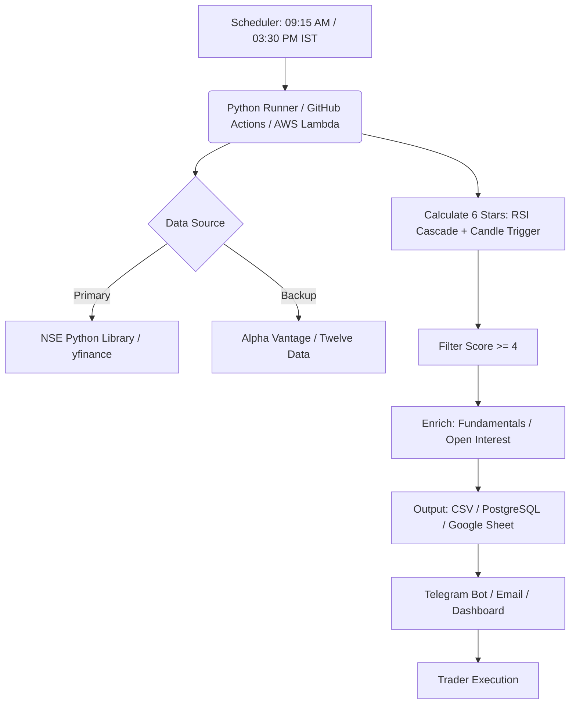

# Deployment Architecture (Professional Grade)

## Notes

- **Scheduler:** run once pre-market (09:15 IST) for the day's watchlist, and once near the
  close (15:30 IST) to catch late-session reversal candles.
- **Data source fallback:** `yfinance` is free but occasionally rate-limited; wire a secondary
  provider (Alpha Vantage / Twelve Data / an NSE-specific library) so a single provider outage
  doesn't blank the scan.
- **Enrichment (optional):** attach fundamentals (P/E, sector weight) or F&O open interest data
  before dispatch, so signals can be filtered further (e.g. exclude illiquid names).
- **Dispatch:** push filtered results to a Telegram bot / email digest / internal dashboard
  rather than requiring someone to run the script manually.
